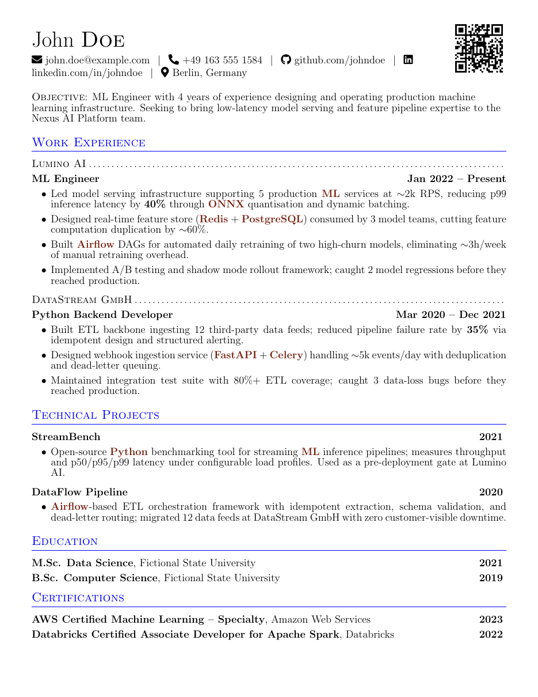
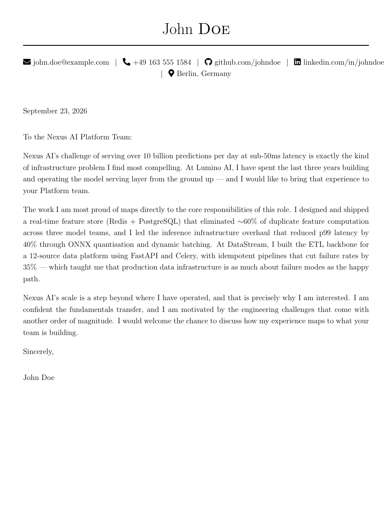

<div align="center">

# expressive-resume-ai

Paste a job posting. [Claude Code](https://claude.ai/code) tells you honestly how well you fit, then writes a resume and cover letter tailored to it, in prose that doesn't read like AI. Your profile and applications stay in your own private git repo, as LaTeX you own.

 

</div>

## Features

- **Honest fit analysis:** your strengths and gaps for the posting, how to frame your experience, and a verdict on whether to apply, saved next to the job posting.
- **Tailored resume and cover letter:** written as LaTeX from your profile and built to PDF, with a row added to your Application Index.
- **Doesn't read like AI:** one set of writing rules bans stock phrases and inflated verbs, and `/copyedit` checks the result in a fresh context against your own writing samples.
- **Your data stays yours:** your profile and applications are plain files in their own git repo, separate from the tool, so a `git add .` in the tool can't publish them.
- **Role Templates:** start each resume from your own reviewed resume for that job family. Claude tailors it without rewording your bullets.
- **Multilingual:** for a posting in another language, you get your documents in both languages, phrased the way a native speaker writes.

## How it works

```
> /review-job
  (paste the job posting)

Fit analysis written to data/applications/26.04.26_mleng@examplecompany/description.md
Strong fit — 7 of 9 core requirements match directly. Recommend applying.

Proceed with creating a tailored CV and cover letter?
> Yes

Built resume.pdf and coverletter.pdf
```

See the fictional example's [fit analysis](example/applications/26.04.26_mleng@examplecompany/description.md), [resume](example/applications/26.04.26_mleng@examplecompany/resume.pdf) and [cover letter](example/applications/26.04.26_mleng@examplecompany/coverletter.pdf).

## Setup

**You need** git, plus a Claude Pro or Max subscription or an Anthropic API key.

1. **Fork** this repository, then clone your fork. To clone without forking, see the [setup guide](docs/guides/setup.md#1-get-the-tool).
2. Install, one of two ways:
   - **Dev Container (recommended):** with Docker, [VS Code](https://code.visualstudio.com/) and its Dev Containers extension installed, open the folder and click **Reopen in Container**. The first start downloads several GB.
   - **Or local** (Linux and macOS): install LaTeX with `latexmk`, then run `./setup.sh`.
3. Run `claude`, then `/login`.
4. Replace the example profile in `data/profile/` with your own work history, projects, qualifications and contact details. **Delete the example projects**, or their fictional content can end up in your resumes.
5. Run `/review-job`, then paste a job posting.

**[Full setup guide](docs/guides/setup.md)**: platforms, API keys, the Dev Container's details, and setup on another machine.

> [!IMPORTANT]
> `data/` is its own private git repo: commit your profile and applications there, and push it to a **private** remote. See [Back up your data](docs/guides/setup.md#5-back-up-your-data).

## Guides

- [Setup](docs/guides/setup.md): every setup option, backups, and getting updates.
- [Applying for a job](docs/guides/applying.md): other ways to pass a job posting, resuming an application, postings in another language, `/translate`, `/copyedit` and building the PDFs.
- [Role Templates](docs/guides/role-templates.md): what they are, and how to create and maintain one.

## Issues and changes

Found a bug or have an idea? [Open an issue](https://github.com/raadon96/expressive-resume-ai/issues). Pull requests aren't accepted: to change the tool, change it in your own fork.

## Acknowledgments

The LaTeX document classes come from [Expressive Resume](https://github.com/thehale/expressive-resume).

## License

MIT. See [LICENSE](LICENSE).
