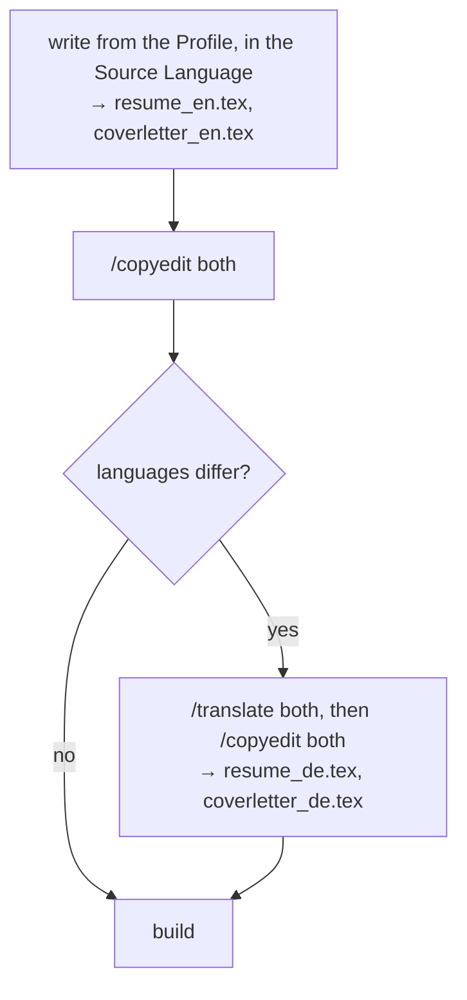

# Every resume is written from the Profile

Every Application's resume and cover letter are written from the Profile, starting from the Scaffold. There is one path, and one language rule: documents are written in the Source Language and, when the Target Language differs, translated by `/translate`, keeping both versions.

## Considered Options

- **Role Templates, tailored within fixed limits** (the previous model, decided in https://github.com/raadon96/expressive-resume-ai/issues/4): rejected. An Application's resume was copied from the user's closest reviewed resume for a job family, and its bullets were never reworded. It kept reviewed wording stable and let a diff show what changed, but it added a second source of wording to keep in sync with the Profile by hand, and three cases per Application, depending on the Role Template's languages.
- **Bullet library in the Profile, every resume assembled from it**: rejected. It means restructuring the Profile and doesn't keep hand-tuned layout.

## Consequences

- Reviewed wording can drift between Applications, because each resume is written anew.
- Every resume needs a full proofread, with no diff to review against.
- A user who wants to reuse a past resume copies it within `data/` and edits it by hand. `/copyedit` and `/translate` work on the copy, and no skill reads it.
- Existing Applications keep their file names. Redoing one leaves its old `resume.tex` beside the new `resume_<code>.tex`.

## Workflow by language

Decided in https://github.com/raadon96/expressive-resume-ai/issues/49.
